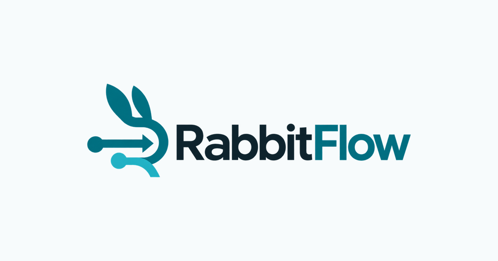
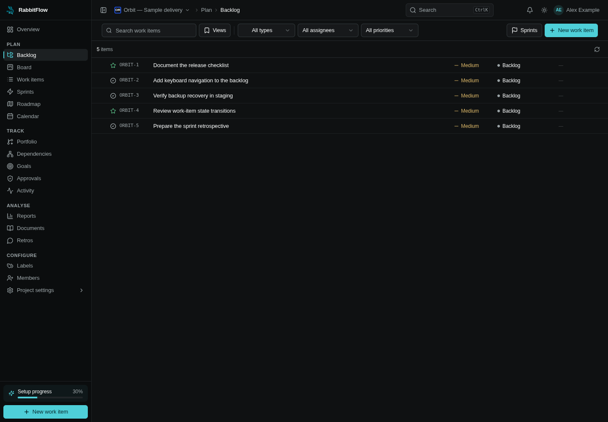

<p align="center"></p>

# Agile delivery. On your infrastructure.

RabbitFlow is an open-source, self-hosted project-management application for engineering teams: plan a backlog, run sprints, and connect work with configurable workflows.

[](LICENSE)
[](https://github.com/guptabibek/rabbitflow/actions/workflows/ci.yml)
[](https://nextjs.org/)
[](https://www.typescriptlang.org/)
[](https://www.postgresql.org/)

**Launch status:** pre-release evaluation. MIT was selected with explicit owner approval. No tagged release exists in the local checkout; a release badge will be added after a verified release exists. See the [final launch report](docs/launch/FINAL_LAUNCH_REPORT.md) for the current evidence and remaining release gates.

[Install](docs/getting-started.md) · [Deploy](docs/deployment.md) · [Contribute](CONTRIBUTING.md) · [Roadmap](ROADMAP.md) · [Support](SUPPORT.md)

## What you can explore

| Workflow | Implementation |
| --- | --- |
| Plan and prioritize | Backlogs, work-item hierarchy, labels, areas, relations |
| Run a sprint | Kanban views, iterations, capacity and sprint analytics |
| Shape your process | Work-item types, fields, states and workflow rules |
| Collaborate with boundaries | Project roles, comments, attachments and activity history |
| Manage identity | JWT sessions, authenticator MFA, account administration |
| Operate yourself | PostgreSQL, optional Redis for native development, Docker production stack |

These features exist in the codebase; their presence is not a production certification. SMTP is needed for email delivery. Redis is required when configured by the Compose stack. [Architecture and evidence](docs/architecture.md).

## Quick start: local Docker evaluation

Requires Git, Docker Engine and Docker Compose v2. Use an isolated machine and synthetic data.

```bash
git clone https://github.com/guptabibek/rabbitflow.git
cd rabbitflow
cp .env.docker.example .env.docker
```

Edit `.env.docker`: generate distinct `JWT_SECRET` (`openssl rand -base64 48`) and `CRON_SECRET` (`openssl rand -hex 32`), and set your own `SEED_ADMIN_EMAIL` and strong `SEED_ADMIN_PASSWORD`. Never commit this file.

```bash
docker compose --env-file .env.docker config --quiet
docker compose --env-file .env.docker up -d --build
```

The evaluation stack listens on port 4080. Check `docker compose --env-file .env.docker logs app` for migration and seed results; a seed failure does not stop the app. Verify `/api/health/ready` returns HTTP 200, then sign in using your configured administrator. Set `RUN_BOOTSTRAP_SEED=false` after success. [Full instructions and caveats](docs/getting-started.md).

Native builds and core browser journeys have been exercised with synthetic data, and the remediated dependency audit reports zero findings. Broader browser and operational release gates remain; consult the final report before using RabbitFlow for important data.

## Develop

Use Node.js 24 (`.nvmrc`), npm, and PostgreSQL 16. The Docker runtime currently uses Node.js 22; the old README's Node 18 guidance was insufficient for the shipped TypeScript scripts.

```bash
npm ci
# Configure .env before the following steps; see the development guide.
npm run db:generate
npx prisma migrate deploy
npm run dev
```

Use migrations on a fresh database: they install full-text-search triggers that `db push` does not create. `npm run db:push` also has a prepare hook that assumes tables already exist. [Development and test databases](docs/getting-started.md).

## Product tour



Actual RabbitFlow UI, captured from the production build using an isolated synthetic project. No customer data or fabricated dashboard is shown. See the [capture guide and storyboard](docs/launch/VISUAL_ASSETS.md) for the wider sprint/analytics/video tour still to be produced.

The existing logo and social card preserve RabbitFlow's teal identity. An isolated [marketing site](site/README.md) is included without changing application routes.

## Architecture and operations

Next.js 16 + React 19 render the UI and serve route handlers. Domain services enforce project permissions and workflow constraints. Prisma connects to PostgreSQL; Redis provides caching and ephemeral coordination. Production Compose adds nginx and a cron caller, isolates database services, and persists uploads outside the web root.

- [Configuration](docs/configuration.md) and [.env.example](.env.example)
- [Deployment, backup, restore and upgrades](docs/deployment.md)
- [Troubleshooting](docs/troubleshooting.md)
- [Security disclosure](SECURITY.md) and [release checklist](docs/launch/RELEASE_CHECKLIST.md)
- [Launch materials](docs/launch/README.md)

## Participate

Try an isolated install and report reproducible problems using the issue templates. Documentation, installation feedback and focused tests are useful first contributions. Read [CONTRIBUTING.md](CONTRIBUTING.md) before sending a pull request, including contribution rights and the MIT license.

[Report a bug](https://github.com/guptabibek/rabbitflow/issues/new/choose) · [Suggest a feature](https://github.com/guptabibek/rabbitflow/issues/new/choose) · [Browse code](https://github.com/guptabibek/rabbitflow)

## License

Licensed under [MIT](LICENSE), selected with explicit owner approval. See the [license decision record](docs/launch/LICENSE_DECISION.md).
