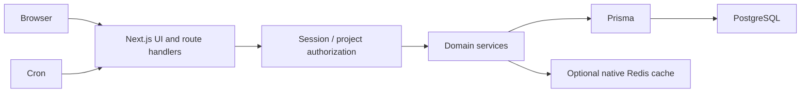

# Architecture and claim evidence

| Claim | Inspectable evidence | Validation boundary |
| --- | --- | --- |
| Boards/backlogs | src/components/project-management, src/app/api/board and backlog | UI and end-to-end journeys pending current-instance startup |
| Workflow/state configuration | src/lib/domain/workflow.ts, state-machine.ts, work-item-types API | Domain runner partially passed; Prisma-dependent files blocked |
| Project roles | src/lib/domain/rbac.ts, auth.ts, integration/authorization.test.ts | Integration execution pending Prisma engine access |
| MFA and persisted sessions | src/lib/auth-otp.ts, crypto-box.ts, auth API, AuthChallenge/AuthSession schema | Not a security certification; MFA encryption key must be configured |
| Reporting | src/app/api/reports, sprint analytics API | Capacity and data correctness require populated staging validation |
| Self-hosting | Dockerfile, Compose files, docker/entrypoint.sh | Full image build/first-deploy/restart drill pending |

UI uses React 19, Tailwind, Radix/shadcn, Zustand and dnd-kit. The same Next.js process serves API handlers; it is not a separate microservice backend. JWT proxy checks are complemented by database-backed identity and permission checks. Attachments are served through authorized handlers outside the public web root. PostgreSQL migrations install full-text indexes/triggers not expressed entirely by Prisma schema sync.

Existing [production-readiness documents](production-readiness/README.md) contain historical assessments, not evidence that release gates passed. [Deployment](deployment.md) supersedes outdated operational instructions in production-upgrade.md.
